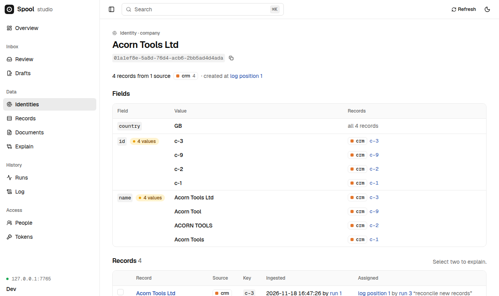

# Spool

Spool decides which records are the same company, person or product, and gives each one an ID that stays the same when more records arrive and when you change the rules.

It is a server you run yourself: one process, written in Rust, with its data in one [DuckDB](https://duckdb.org) file. Matching rules are SQL files that you keep in Git. You drive it from the command line, over HTTP, or from an agent over MCP, and it has a browser interface for looking at the data and correcting it.

Working out which records are the same thing is called entity resolution, or record linkage. Tools that do it give you clusters whose IDs belong to one run. Spool keeps the IDs: a new row joins the identity that exists, and a better rule produces a list of suggested merges, not new IDs.

```sh
curl -fsSL https://github.com/alexpatow/spool/releases/latest/download/install.sh | sh
spool init companies && cd companies
spool dev
```

In a second terminal, in `companies`:

```sh
spool load samples/crm-1.csv
spool match
spool show records
```

The last command prints this, after a first column of record IDs that is left out here to fit:

```text
source and key  name                 identity
crm:c-1         Acorn Tools          01a1ef8e-5a8d-76d4-acb6-2bb5ad4d4ada
crm:c-2         ACORN TOOLS          01a1ef8e-5a8d-76d4-acb6-2bb5ad4d4ada
crm:c-3         Acorn Tools Ltd      01a1ef8e-5a8d-76d4-acb6-2bb5ad4d4ada
crm:c-4         Larkfield Logistics  01a1ef8e-5a8d-76d4-acb6-2bb802d5ca25
crm:c-5         Halden Group         01a1ef8e-5a8d-76d4-acb6-2bb793e9d0ae
crm:c-6         Halden Group         01a1ef8e-5a8d-76d4-acb6-2bb65a02262a
```

Three spellings of Acorn Tools share an ID. The two Halden Groups are in different countries, and a rule keeps them apart.

Version 0.1.0, for Linux and macOS. The first commit was on 14 November 2026, and nobody runs it in production yet. It is not for deduplicating one file once, for an answer per request, or for more than one machine: before you spend time on it, read [What it is not for](#what-it-is-not-for) and [What it does not do](#what-it-does-not-do).

## Getting started

The commands above are all of it. This section says what each needs and does, and then goes on from the result.

You need Linux on x86-64 or arm64, or macOS on Apple silicon, and `curl`. There is no Windows build.

**Install.** The script downloads the release for your machine, checks it against its checksum, unpacks it under `~/.local/share/spool/0.1.0` and links `~/.local/bin/spool`. It needs no root and changes nothing else. To do it by hand, download `spool-0.1.0-<target>.tar.gz` from the [release](https://github.com/alexpatow/spool/releases/tag/v0.1.0), unpack it and put its `bin` directory on your search path. Keep `bin` and `lib` together: the binary loads the DuckDB library from `../lib`. `spool --version` prints `spool 0.1.0`.

**Create a project.** `spool init companies` writes a directory of files that you keep in Git. `sources/crm.yaml` lists the columns of a source of rows. `entities/company/` describes an entity type, which is a kind of thing you want one ID for, and holds three rules of one line of SQL each. `samples/` holds two files of rows to load. The first is `samples/crm-1.csv`:

```csv
id,name,country
c-1,Acorn Tools,GB
c-2,ACORN TOOLS,GB
c-3,Acorn Tools Ltd,GB
c-4,Larkfield Logistics,GB
c-5,Halden Group,GB
c-6,Halden Group,US
```

**Start the server.** `spool dev` listens on `127.0.0.1:7765` only and asks nobody to sign in. Its data is in `.spool/dev.duckdb` inside the project, and it applies changes to the project's files as you save them. Leave it running.

**Load and match.** `spool load` makes each row a record. Loading does not match, and loading the same file again adds nothing. `spool match` judges the records that are new, against each other and against the ones the store holds, and places them in identities. An identity is one company, with its ID and the records that belong to it. That ID, in the last column of `spool show records`, is what other systems store.

The ID of an identity is minted when the identity is created, so yours will differ from the ones here. The ID of a record is derived from its source, its key and its content, so yours will be the same.

### Ask why

```sh
spool explain crm:c-5 crm:c-6
```

```text
`crm:c-6` belongs to identity 01a1ef8e-5a8d-76d4-acb6-2bb65a02262a and `crm:c-5` to identity 01a1ef8e-5a8d-76d4-acb6-2bb793e9d0ae.
Run 2 (strategy `rules`) judged them `no_match` (no_match rule `different_country` held).
...
```

A rule is a file that holds a SQL condition over two records, `l` and `r`. These are the three in the project. The first says which pairs get compared at all, the second matched "Acorn Tools Ltd" to "Acorn Tools", and the third kept the two Halden Groups apart. `name_key` is `lower(trim(name))`.

```sql
-- entities/company/rules/block/name_prefix.sql
left(l.name_key, 4) = left(r.name_key, 4)

-- entities/company/rules/match/similar_name.sql
jaro_winkler_similarity(l.name_key, r.name_key) >= 0.92

-- entities/company/rules/no_match/different_country.sql
l.country <> r.country
```

### Send more rows

```sh
spool load samples/crm-2.csv
spool match
spool show records
```

It prints the six lines from before, unchanged, and then three more:

```text
crm:c-7         Larkfeild Logistics  01a1ef8e-5a8d-76d4-acb6-2bb802d5ca25
crm:c-8         Kestrel Analytics    01a1ef8e-5f06-7397-9a0c-445aaacfd3fe
crm:c-9         Acorn Tool           01a1ef8e-5a8d-76d4-acb6-2bb5ad4d4ada
```

"Larkfeild Logistics" and "Acorn Tool" joined the identities that existed, and those kept their IDs. Kestrel Analytics is new and got a new one. Nothing that was placed before moved.

### Over HTTP

Each command is a call to the HTTP API, which calls loading "ingest" and a match a "run". The same four steps:

```sh
curl -s -X POST 'http://127.0.0.1:7765/v1/ingest?source=crm&entity_type=company' -H 'content-type: text/csv' --data-binary @samples/crm-1.csv
curl -s -X POST http://127.0.0.1:7765/v1/runs -d '{"entity_type": "company"}'
curl -s 'http://127.0.0.1:7765/v1/records?source=crm'
curl -s 'http://127.0.0.1:7765/v1/explain?a=crm:c-5&b=crm:c-6'
```

Each answers with one line of JSON.

### From an agent

The server speaks the Model Context Protocol at `http://127.0.0.1:7765/mcp`, and `spool dev` asks for no token. For Claude Code, and for Codex:

```sh
claude mcp add --transport http spool http://127.0.0.1:7765/mcp
codex mcp add spool --url http://127.0.0.1:7765/mcp
```

The agent gets tools that load rows (`load_rows`), start a match (`run_match`), search records and identities, explain a pair (`explain_pair`), and merge, split and undo. Ask it, for example, to load `samples/crm-2.csv`, match it, and say why c-5 and c-6 are different companies.

### In a browser

The studio is at <http://127.0.0.1:7765/>. It shows the same records, identities and explanations, and it can merge two identities, split one and undo a change. This is its page for the identity of Acorn Tools after the second batch:



### Stop, and your own rows

Ctrl-C in the first terminal stops the server. The data stays in `.spool/dev.duckdb`. To start from nothing, stop the server and delete `.spool`. For your own rows, edit the columns in `sources/crm.yaml` and the rules, then run `spool load your-file.csv`.

## What it is not for

These follow from the design. Where something else fits better, it is named. What is said about other tools comes from reading their code and documentation in November 2026, not from running them beside Spool: see the [survey](docs/landscape-survey.md).

- **Deduplicating one file once.** Spool exists to keep IDs the same as data arrives over time. If you have one file, will get no more, and nobody stores the IDs, use [Splink](https://github.com/moj-analytical-services/splink) or [dedupe](https://github.com/dedupeio/dedupe).
- **Matching without rules of your own.** The built-in matcher runs SQL conditions that you write. There is no trained model in it. Splink, dedupe and [Zingg](https://github.com/zinggAI/zingg) each learn one. A model can also judge pairs for Spool, through code of yours called a strategy, and Spool keeps the identities: `benchmarks/resolution/people` has one that runs Splink.
- **An answer per record, inside the request.** Rows are loaded in batches and matched by runs. Loading a row does not say whether it is a duplicate. [Senzing](https://senzing.com), which is proprietary, resolves each record as it arrives.
- **The same result whatever order rows arrive in.** Two records that were each placed alone stay apart until someone merges them, even when a later rule matches them. That is the cost of IDs that do not move.
- **Exact matching on a key you trust.** If two rows are the same thing whenever their tax numbers are equal, a join in your database is enough.
- **Data that is already in the FollowTheMoney format.** [nomenklatura](https://github.com/opensanctions/nomenklatura) keeps stable IDs for people and companies in that format.
- **Streaming.** There is no connection to Kafka or to a change feed. Something else has to collect rows and send them.
- **More than one machine, or more than one writer.** One server process owns one DuckDB file and uses the cores and memory of one machine. There is no replication and no clustering.
- **Several tenants in one server.** A store holds one project.
- **Embedding in your process.** There are no Python or Node bindings. Your code calls the server over HTTP, and no client library is published for that.
- **Golden records.** Spool says which records are one thing. It does not produce one merged record with the best name and address, and it writes nothing back to a source.

## What it does not do

- **Packages.** A release is an archive for Linux on x86-64 and arm64 and for macOS on Apple silicon, and a container image. There is no Homebrew, apt or Cargo package and no Windows build. Spool is two files, the binary and the DuckDB library in `lib` beside it, and there is no single static binary.
- **Connectors.** `spool load` reads CSV files. Nothing reads a database, a warehouse or a file store.
- **Corrections from the command line.** The command line loads, matches, takes rows back, shows and explains. Merging, splitting, undoing and deciding a review item are HTTP calls, MCP tools or buttons in the studio.
- **Erasing a row.** `spool retract` takes a row that its source no longer holds out of its identity and out of matching, and the row stays in the store. A row loaded by mistake, by a person or by an agent, cannot be removed, and neither can a person's data on request.
- **A row that changes from A to B and back to A stays at B.** The second A is content the server has seen under that key, so it is ignored.
- **Limits on an agent.** Over MCP an agent can load rows and start runs, in requests of 4 MiB at most. It cannot approve a draft, add a person or make a token.
- **Access is all or nothing.** A token has full access to the API and does not expire, though it can be revoked, so an agent that may read may also load. People sign in with a password or with Google, and with no other identity provider.
- **Notifying anyone.** Nothing is pushed when an identity changes. A consumer reads the log of changes from the position it last saw.
- **Backups and upgrades.** There is no backup command, and nothing is promised about a store written by one version opening in the next.
- **Runtimes for your own code.** A strategy in Python needs [`uv`](https://docs.astral.sh/uv/) on the machine and one in TypeScript needs [`bun`](https://bun.sh). Spool brings neither, and nothing looks for either until such a file runs.
- **Size.** The largest set it has been measured on is 5,000,000 records: 210 seconds and 13.4 GB of memory on four cores, matching the whole set from nothing, at pair precision 0.880 and recall 0.879. [benchmarks/README.md](benchmarks/README.md) has the measurements and how they were made. A request to the API may be 256 MiB at most.

## Where next

- `spool` with no arguments lists the commands, and `spool <command> --help` describes each.
- [docs/mcp.md](docs/mcp.md): the tools an agent gets, and how to connect each client.
- [docs/sign-in.md](docs/sign-in.md): running a server that other people sign in to.
- [benchmarks/README.md](benchmarks/README.md): projects with more sources and rules than the one above, on public data, and what was measured on them.
- [docs/landscape-survey.md](docs/landscape-survey.md): the other tools that were read, and where Spool differs.
- [docs/architecture-proposal.md](docs/architecture-proposal.md): the design. What records, judgements, identities, constraints and changesets are, and how strategies run.
- Bugs and questions: [open an issue](https://github.com/alexpatow/spool/issues).

## Licence

MIT. See [LICENSE](LICENSE).
